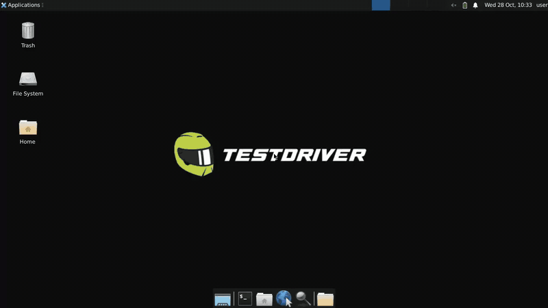

# How to Automate Testing of a Java Swing Application


[](https://console.testdriver.ai/replay/6ae1d017c2408c0c2459d12a?share=FUZqiIUR1GqUtfkGE4INhg)

*Sped up: idle time removed. Click to watch the full replay with step-by-step logs.*

This repo is the complete, runnable example from the TestDriver tutorial **[How to Automate Testing of a Java Swing Application](https://testdriver.ai/blog/test-java-swing-app)**. The post walks through every line.

## What the test does

Launch JMeter, right-click Test Plan > Add > Threads > Thread Group, set Number of Threads to 5, assert the field shows 5.

It runs on a fresh cloud machine, installs the app the way a user would, and drives it from screenshots with plain-language steps. No selectors, test IDs or changes to the app.

## Run it

You need Node.js 20+ and a TestDriver API key (free to start at [console.testdriver.ai](https://console.testdriver.ai)).

```bash
git clone https://github.com/testdriverai/example-java-swing-app.git
cd example-java-swing-app
npm install
cp .env.example .env   # then paste your key into .env
npx vitest run
```

The run prints a link to its replay, so you can watch what happened.

## Run it in CI

[`.github/workflows/testdriver.yml`](.github/workflows/testdriver.yml) runs the test on every push and pull request using [`testdriverai/action`](https://github.com/testdriverai/action). Set up OIDC for your team, or add your key as a repository secret named `TD_API_KEY`. See [CI/CD](https://docs.testdriver.ai/ci-cd).

## Files

- [`tests/java-swing-app.test.mjs`](tests/java-swing-app.test.mjs): the test
- [`vitest.config.js`](vitest.config.js): Vitest with the TestDriver reporter
- [`.github/workflows/testdriver.yml`](.github/workflows/testdriver.yml): CI

## Learn more

- Tutorial: https://testdriver.ai/blog/test-java-swing-app
- Docs: https://docs.testdriver.ai/quickstart
- More examples: https://docs.testdriver.ai
